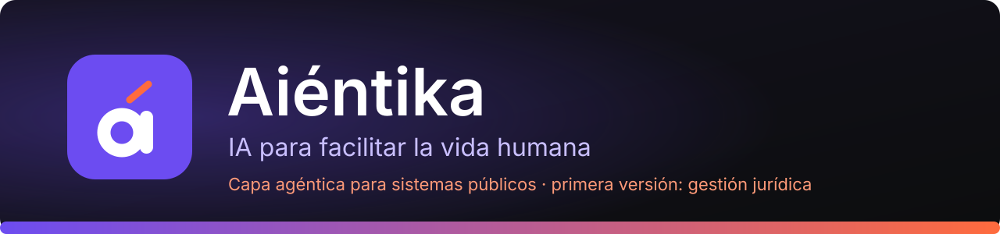
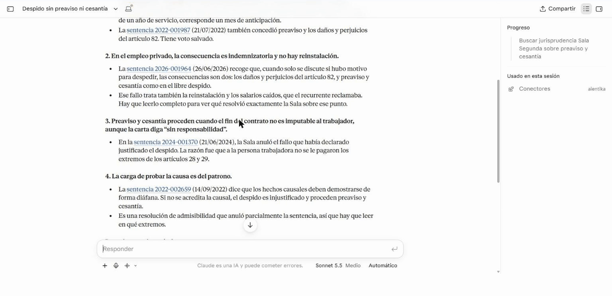
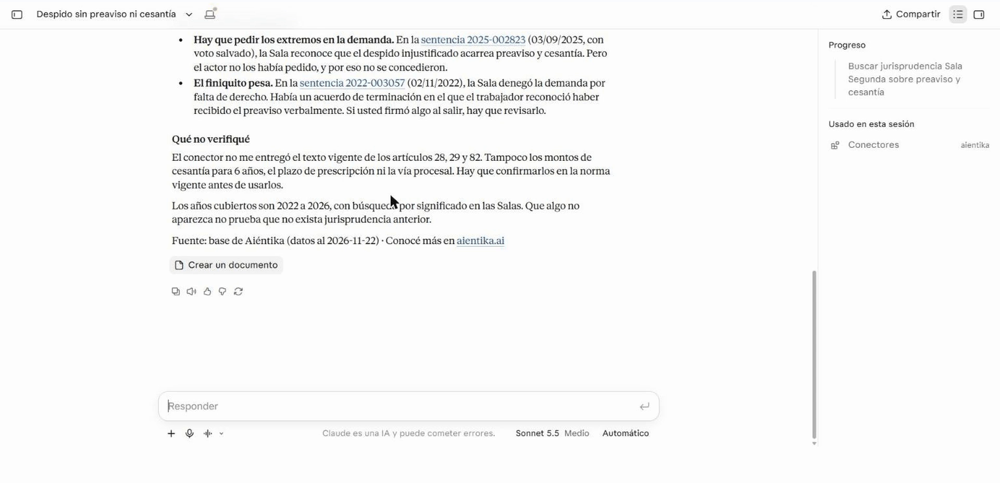
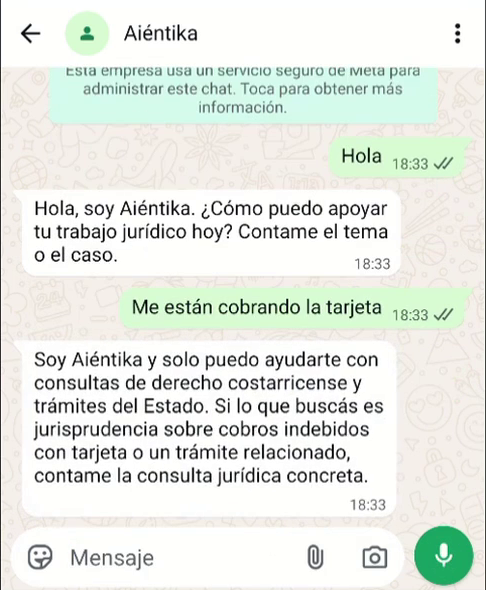
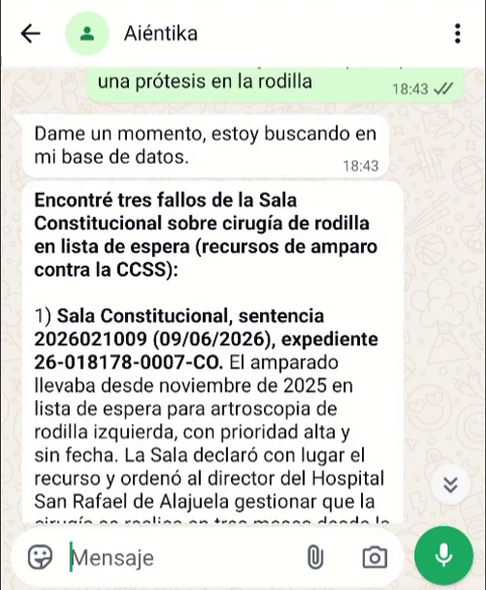

<p align="center">
  
</p>

<p align="center">
  <a href="https://aientika.ai"></a>
  <a href="LICENSE"></a>
  
  
  
</p>

<p align="center">
  🌐 <b><a href="https://aientika.ai">aientika.ai</a></b> &nbsp;·&nbsp; 🇬🇧 <a href="README.md">English</a> &nbsp;·&nbsp; 🇨🇷 Español
</p>

# Aiéntika — capa agéntica para sistemas públicos

> [!TIP]
> **Probalo, instalalo, pedí acceso:** todo lo que necesita una persona usuaria (instalarlo en Claude o ChatGPT, ejemplos de uso y solicitud de acceso) está en **[aientika.ai](https://aientika.ai)**. Este repositorio es el código del conector.

Aiéntika es una **capa agéntica para sistemas públicos**: un conjunto de agentes que buscan, ordenan y explican la información pública,
siempre con la fuente a la vista. Su **primera versión es para la gestión de temas jurídicos** en Costa Rica: jurisprudencia y trámites
del Estado, con citas verificadas mecánicamente.

Este repositorio contiene la pieza que conecta esa capa con los asistentes que la gente ya usa: un conector [MCP](https://modelcontextprotocol.io)
remoto que permite a Claude y a ChatGPT responder preguntas sobre **jurisprudencia y trámites del Estado de Costa Rica** sin inventar. No genera texto jurídico por su cuenta: le entrega al asistente
fragmentos verificados, enlaces oficiales y los límites exactos de lo que dicen los datos.

> [!NOTE]
> Este repositorio contiene **solo el conector**. El índice de jurisprudencia que consulta (un RAG que ya existe y vive en un servicio
> privado aparte) no forma parte de este repositorio. **Durante la hackathon incorporamos capacidades de gestión jurídica mediante WhatsApp** (piloto cerrado); ese canal no se incluye aquí.

## Ejemplos

**En Claude** (una consulta laboral formulada como la haría un abogado; la respuesta cita cada fallo con su enlace oficial y cierra con lo que *no* se verificó):




**En WhatsApp** (piloto cerrado; el código del canal no está en este repositorio). Las mismas fuentes verificadas, con preguntas en lenguaje cotidiano de alguien que no es jurista:

<p>


</p>

**La respuesta ajusta su léxico según quién pregunta.** Con un profesional del derecho, el agente usa lenguaje técnico (artículos, salas, números de sentencia, términos procesales). Con una persona no jurista, explica en palabras sencillas, evita la jerga y dice qué conviene revisar después. En ambos casos las reglas no cambian: cada fallo trae su enlace oficial, la respuesta declara hasta qué fecha llegan los datos y qué no verificó, y no se cita nada que no pueda comprobarse contra el texto de la fuente.

## El problema

Los asistentes jurídicos fallan de una manera muy concreta: producen una cita o una norma que *parece* correcta y no lo es. En derecho
eso no es un error cosmético, es una sanción esperando ocurrir. El conector está construido alrededor de una regla: **no se cita nada que
no se pueda comprobar mecánicamente contra el texto de la fuente.**

## Qué hace

Nueve herramientas MCP (`src/conector/servidor.py`):

| Herramienta | Qué devuelve |
|---|---|
| `aientika_buscar_jurisprudencia_cr` | Fragmentos ordenados de fallos costarricenses (búsqueda literal y por significado), cada uno con la etiqueta de su sección, un enlace oficial y una línea de cobertura que dice qué años se pueden buscar y cómo |
| `aientika_ficha_de_fallo` | Ficha estructurada de un fallo (despacho, fecha, parte dispositiva, marca de disidencia) |
| `aientika_verificar_cita_de_fallo` | Comprueba que una frase citada aparece **literal** en un fallo e indica *dónde* cae (dispositiva, considerandos, alegato de parte, voto salvado, nota) |
| `aientika_buscar_tramites_cr` / `aientika_ficha_de_tramite` | Búsqueda y detalle de ~2.000 trámites del Estado del catálogo nacional de trámites, citando siempre la ficha, la fecha y el enlace |
| `aientika_catalogo_de_fuentes` | Qué fuentes existen, qué tan frescas están y cuáles no están cubiertas |
| `aientika_visitar_sitio`, `aientika_ayuda`, `aientika_reportar_respuesta` | Tarjeta del sitio, ayuda y un canal para reportar respuestas malas |

## Decisiones de diseño que vale la pena leer

1. **Fragmentos, nunca el texto completo.** El conector devuelve fragmentos y el enlace oficial; la persona abre el fallo para leerlo.
2. **Cada fragmento dice qué es.** Las secciones vienen rotuladas (`alegato`, `antecedente`, `veredicto`, `voto_salvado`, …) y el conector
   *nunca* afirma que algo sea el criterio de la Sala. Mayoría y minoría se mantienen separadas.
3. **Un cero nunca es un dato.** Una búsqueda vacía no prueba que no exista jurisprudencia; una caída de la base devuelve un error en
   palabras, nunca una lista vacía (`src/conector/bd.py`, `buscar.py`).
4. **La frescura se declara.** Cada respuesta abre con una línea de cobertura con la fecha de corte de los datos.
5. **Ninguna norma de memoria.** Las instrucciones que recibe el modelo (`instrucciones.py`, primeros 512 caracteres) prohíben citar
   artículos que el conector no entregó y prometer escritos «listos para presentar».
6. **Privacidad por construcción.** Las consultas se anonimizan por datos personales antes de guardarse (`anonimizar.py`), se guardan
   90 días y el rol de base de datos del conector es de mínimo privilegio. Los códigos de invitación solo se guardan como hash.
7. **Topes de costo en la capa semántica.** Las llamadas de embeddings se miden contra un presupuesto duro (`presupuesto_voyage.py`, `indice/tope_voyage.py`).
8. **Cortés con terceros.** Las peticiones salientes llevan un `User-Agent` genérico y el conector nunca evade controles de acceso.

Estas reglas están escritas en [`CONSTITUTION.md`](CONSTITUTION.md) y cubiertas por pruebas automáticas.

## Estructura del repositorio

```
src/conector/     el servidor MCP: herramientas, búsqueda, verificación de citas, límites, OAuth, registro, sitio estático
src/indice/       solo los módulos que importa el conector (esquema, extractos de texto, cliente de embeddings, tope de gasto)
src/apoyo/        un pequeño módulo de apoyo (dos definiciones que usa el tope de gasto)
src/agentika_contacto/  utilidad de alta y baja de contacto
tests/unit/           523 pruebas; corren con simulaciones: sin red, sin base de datos y sin cuenta de nube
scripts/              script de despliegue (imprime comandos gcloud, no ejecuta nada), herramientas de invitaciones e informe de uso
docs/architecture/conector_changelog.md   contrato versionado de las herramientas y sus cambios
```

## Correr las pruebas

```bash
python -m venv .venv && . .venv/bin/activate        # Python 3.14
pip install -r requirements-conector.txt pytest
python -m pytest tests/unit -q                       # 523 pasan
```

La suite no necesita credenciales. Para servir datos de verdad hace falta una base PostgreSQL con el esquema esperado
(`src/indice/esquema.py`) y las variables de entorno que lista `scripts/deploy_conector.sh`.

## Qué existía antes de la hackathon y qué se hizo durante ella

Este es un **proyecto existente**. Según las reglas de la hackathon, esta es la separación, tomada del historial real de git del
repositorio privado del que sale esta copia (el historial no se incluye: tiene notas operativas y datos personales).

**Antes del 20 de noviembre de 2026 (decenas de commits al conector desde el 10 de noviembre):** el servidor MCP y sus nueve herramientas, la búsqueda
de jurisprudencia y el verificador de citas, la clasificación de secciones, el catálogo de trámites, los límites de uso y topes de presupuesto,
OAuth y registro por invitación, anonimización y registro de uso, el sitio público y el contrato versionado.

**Durante la ventana de la hackathon (20 al 22 de noviembre de 2026), en este repositorio:**

- **20 nov:** el servicio atiende las 24 horas.
- **21 nov:** diseño y primera etapa del registro por correo con código de un solo uso (tabla `codigo_correo` y su lógica, código de 6 dígitos,
  límites de intentos, presupuestos de envío por invitación y globales) — construido y probado, sin desplegar.
- **22 nov:** logo de la marca en el sitio público; este repositorio: exportación limpia, script de despliegue genérico, licencia y README en inglés y español.

- **No está en este repositorio:** durante la hackathon incorporamos capacidades de gestión mediante WhatsApp (piloto cerrado): el mismo
  conector, usado desde un chat. Su código es privado.

Somos explícitos: la mayor parte del conector es anterior a la hackathon.

## Cómo se usaron las herramientas de IA para programar

El código se escribió con Claude Code bajo reglas de proyecto escritas (una constitución, especificaciones por funcionalidad antes del código,
una prueba con cada corrección y «verificar resultados, no componentes» antes de cerrar cualquier cosa).

## Qué no está incluido

> [!IMPORTANT]
> El núcleo del agente que corre sobre este conector (su lógica de conversación, prompts, guarda de respuestas, controles de costo e
> integraciones de canal) **no forma parte de este repositorio y no está licenciado por él**. Se mantiene como información no divulgada
> (secreto comercial) bajo la Ley N.° 7975 de Costa Rica, del 4 de enero de 2000, *Ley de Información no Divulgada*. Publicar el conector
> bajo Apache-2.0 no otorga ningún derecho sobre él.

## Más información

- 🌐 Sitio, instalación y ejemplos de uso: **[aientika.ai](https://aientika.ai)**
- 📜 Principios del proyecto: [`CONSTITUTION.md`](CONSTITUTION.md)
- 🧾 Contrato versionado de las herramientas: [`docs/architecture/conector_changelog.md`](docs/architecture/conector_changelog.md)

## Agradecimientos

Gracias a **Dojo** por el tip y por la Dojo AI Hackathon.

## Licencia

Apache License 2.0 — ver [`LICENSE`](LICENSE).
