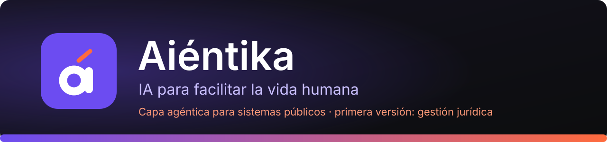

<p align="center">
  
</p>

<p align="center">
  <a href="https://aientika.ai"></a>
  <a href="LICENSE"></a>
  
  
  
</p>

<p align="center">
  🌐 <b><a href="https://aientika.ai">aientika.ai</a></b> &nbsp;·&nbsp; 🇬🇧 English &nbsp;·&nbsp; 🇨🇷 <a href="README.es.md">Español</a>
</p>

# Aiéntika — an agentic layer for public systems

> [!TIP]
> **Try it, install it, request access:** everything for users (install in Claude or ChatGPT, usage examples, access request) lives at **[aientika.ai](https://aientika.ai)**. This repository is the connector's code.

Aiéntika is an **agentic layer for public systems**: a set of agents that find, organize and explain public information, always
with the source in view. Its **first version is for managing legal matters** in Costa Rica: case law and government procedures,
with citations verified mechanically.

This repository holds the piece that connects that layer to the assistants people already use: a remote
[MCP](https://modelcontextprotocol.io) connector that lets Claude and ChatGPT answer questions about
**Costa Rican case law and government procedures** (trámites) without making things up. It does not generate legal text on
its own: it hands the assistant verified fragments, official links and the exact limits of what the data says.

> [!NOTE]
> This repository contains **the connector only**. The case-law index it queries (a RAG that already exists and is kept
> in a separate, private service) is not part of this repository. **During the hackathon we incorporated legal-matter management capabilities through WhatsApp** (closed pilot); that channel is not included here.

## The problem

Legal assistants fail in a specific way: they produce a quote or a norm that *looks* right and is not. In law that is not a
cosmetic bug, it is a sanction waiting to happen. The connector is built around one rule: **nothing is cited that cannot be
checked mechanically against the source text.**

## What it does

Nine MCP tools (`src/conector/servidor.py`):

| Tool | What it returns |
|---|---|
| `aientika_buscar_jurisprudencia_cr` | Ranked fragments of Costa Rican court rulings (literal + semantic search), each with its section label, an official link and a coverage line stating which years are searchable and how |
| `aientika_ficha_de_fallo` | Structured card of one ruling (court, date, operative part, dissent flag) |
| `aientika_verificar_cita_de_fallo` | Checks that a quoted sentence appears **literally** in a ruling and reports *where* it falls (operative part, reasoning, party argument, dissent, note) |
| `aientika_buscar_tramites_cr` / `aientika_ficha_de_tramite` | Search and detail of ~2,000 government procedures from the national procedures catalog, always citing the card, date and link |
| `aientika_catalogo_de_fuentes` | Which sources exist, how fresh they are, and which are not covered |
| `aientika_visitar_sitio`, `aientika_ayuda`, `aientika_reportar_respuesta` | Site card, help, and a feedback channel for bad answers |

## Design choices worth reading

1. **Fragments, never full text.** The connector returns fragments plus the official link; the user opens the ruling to read it.
2. **Every fragment says what it is.** Sections are labelled (`alegato`, `antecedente`, `veredicto`, `voto_salvado`, …) and the connector
   *never* claims that something is the court's holding. Majority and minority are kept apart.
3. **A zero is never data.** An empty search does not prove no case law exists; a database outage returns an error in words, never an
   empty list (`src/conector/bd.py`, `buscar.py`).
4. **Freshness is declared.** Each answer opens with a coverage line with the data cut-off date.
5. **No norms from memory.** The instructions the model receives (`instrucciones.py`, first 512 characters) forbid quoting articles
   the connector did not deliver, and forbid promising "ready to file" briefs.
6. **Privacy by construction.** Queries are anonymized for personal data before being stored (`anonimizar.py`), kept 90 days, and the
   database role used by the connector is least-privilege. Invitation codes are stored only as hashes.
7. **Cost caps on the semantic layer.** Embedding calls are metered against a hard budget (`presupuesto_voyage.py`, `indice/tope_voyage.py`).
8. **Polite with third parties.** Outbound requests go out with a generic `User-Agent`, and the connector never evades access controls.

These rules are written down in [`CONSTITUTION.md`](CONSTITUTION.md) (Spanish) and covered by automated tests.

## Repository layout

```
src/conector/     the MCP server: tools, search, citation verification, limits, OAuth, registration, static site
src/indice/       only the modules the connector imports (schema, text extracts, embedding client, spend cap)
src/apoyo/        a tiny support stub (two definitions used by the spend cap)
src/agentika_contacto/  contact opt-in/out helper
tests/unit/           523 tests; they run with fakes: no network, no database, no cloud account
scripts/              deploy script (prints gcloud commands, runs nothing), invitations and usage report tools
docs/architecture/conector_changelog.md   versioned tool contract and its changes
```

## Run the tests

```bash
python -m venv .venv && . .venv/bin/activate        # Python 3.14
pip install -r requirements-conector.txt pytest
python -m pytest tests/unit -q                       # 523 passed
```

The suite needs no credentials. To actually serve data you need a PostgreSQL database with the expected schema
(`src/indice/esquema.py`) and the environment variables listed in `scripts/deploy_conector.sh`.

## What existed before the hackathon, and what was done during it

This is an **existing project**. Per the hackathon rules, here is the split, taken from the real git history of the private
repository this snapshot was exported from (the history is not included: it contains operational notes and personal data).

**Before Nov 20, 2026 (dozens of commits to the connector since Nov 10):** the MCP server and its nine tools, the case-law search and
citation verifier, section classification, the procedures catalog, rate limits and budget caps, OAuth and invitation registration,
anonymization and usage logging, the public site, and the versioned contract.

**During the hackathon window (Nov 20–22, 2026), in this repository:**

- **Nov 20:** the service runs 24 hours a day.
- **Nov 21:** design and first stage of registration by e-mail with a one-time code (new `codigo_correo` table and logic, 6-digit
  code, attempt limits, per-invitation and global send budgets) — built and tested, not deployed.
- **Nov 22:** brand logo on the public site; this repository: cleaned export, generic deploy script, license, English and Spanish READMEs.

- **Not in this repository:** during the hackathon we incorporated management capabilities through WhatsApp (closed pilot): the same
  connector, reached from a chat. Its code is private.

We are being explicit that most of the connector predates the hackathon.

## How AI coding tools were used

The code was written with Claude Code under written project rules (a constitution, per-feature specs before code, a test with every
fix, and "verify results, not components" before closing anything).

## What is not included

> [!IMPORTANT]
> The core of the agent that runs on top of this connector (its conversation logic, prompts, answer guard, cost controls and
> channel integrations) is **not part of this repository and is not licensed by it**. It is kept as undisclosed information
> (trade secret) under Costa Rican Law No. 7975 of January 4, 2000, *Ley de Información no Divulgada*. Publishing the connector
> under Apache-2.0 grants no rights over it.

## More information

- 🌐 Site, installation and usage examples: **[aientika.ai](https://aientika.ai)**
- 📖 Spanish version of this README: [`README.es.md`](README.es.md)
- 📜 Project principles: [`CONSTITUTION.md`](CONSTITUTION.md) (Spanish)
- 🧾 Versioned tool contract: [`docs/architecture/conector_changelog.md`](docs/architecture/conector_changelog.md)

## Acknowledgements

Thanks to **Dojo** for the tip and for the Dojo AI Hackathon.

## License

Apache License 2.0 — see [`LICENSE`](LICENSE).
